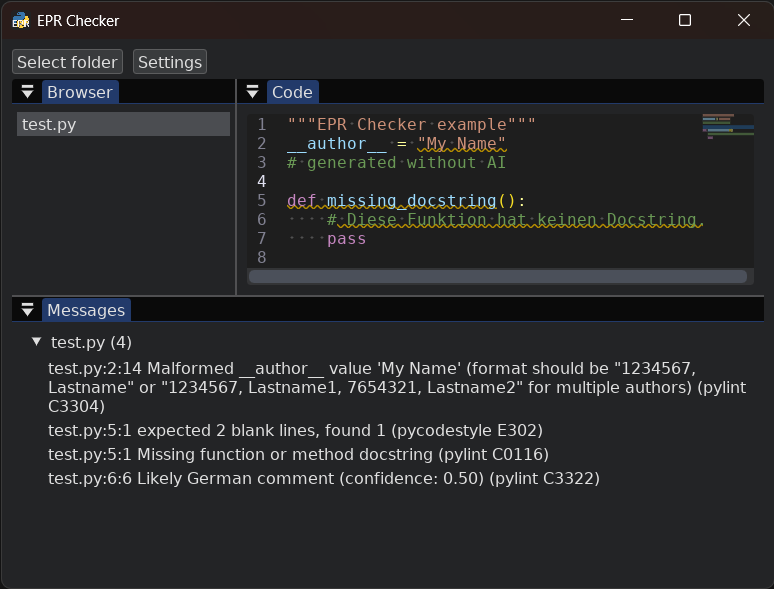
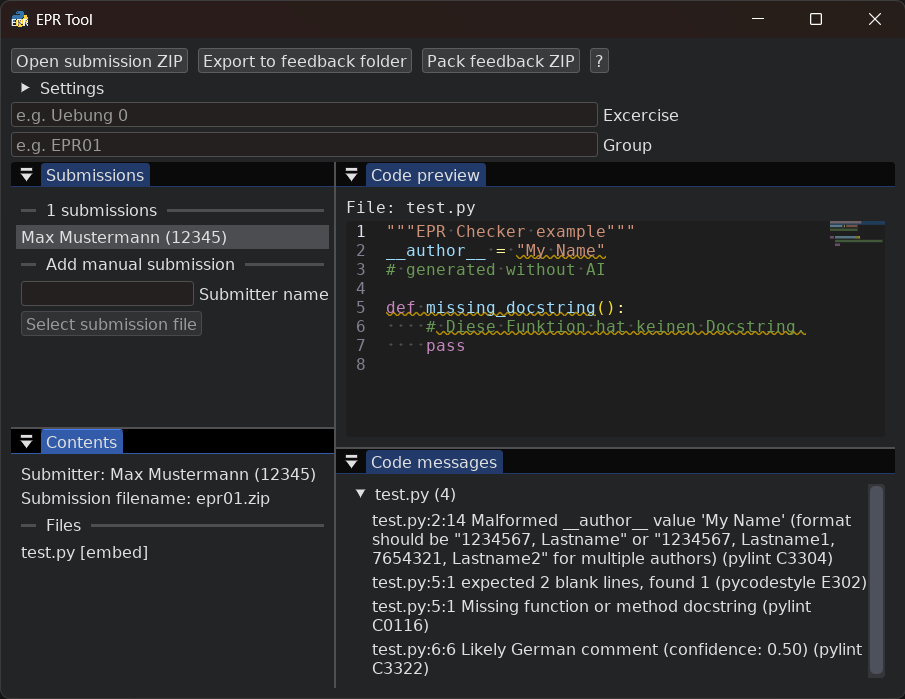

# eprtool and eprcheck

## eprcheck (for students)

### Running
- [Windows EXE (64-bit)](https://github.com/xypwn/eprtool/releases/latest/download/eprcheck.exe)
- [Linux executable (64-bit, archived)](https://github.com/xypwn/eprtool/releases/latest/download/eprcheck-linux.tar.xz)
- Any OS (via uvx):
    - Make sure [uv](https://docs.astral.sh/uv/getting-started/installation/) is installed
    - `uvx --from git+https://github.com/xypwn/eprtool eprcheck`

### Features
- A single simple graphical program
- Check EPR-specific PEP-8 and custom rules using pylint and pycodestyle
    - `__author__` variable correctness
    - Presence of AI usage information
    - Warn if inferred comment or docstring language is German
    - Many pylint and pycodestyle rules
        - See [here](https://github.com/xypwn/eprtool/blob/main/src/common/stylecheck.py#L19) for exact pylint rules applied
- File watching: Once a folder is opened, it is automatically watched for updates
    - Changed files are re-loaded and re-linted automatically
    - The code view automatically scrolls to the new change

## eprtool (for tutors)

### Running
- [Windows EXE (64-bit)](https://github.com/xypwn/eprtool/releases/latest/download/eprtool.exe)
- [Linux executable (64-bit, archived)](https://github.com/xypwn/eprtool/releases/latest/download/eprtool-linux.tar.xz)
- Any OS (via uvx):
    - Make sure [uv](https://docs.astral.sh/uv/getting-started/installation/) is installed
    - `uvx --from git+https://github.com/xypwn/eprtool eprtool`
Note that the eprtool executables quite big, since they include [typst](https://github.com/typst/typst) for PDF generation, as well as dearimgui_bundle, Python other large libraries.

### Usage
<!--generate: export src/common/res/EPRTOOL_HELP.md-->
#### 0. Configure settings
In "Settings":
- Set "Tutor" to the title of your tutoring group(s) (e.g. "EPR 01/02 - Firstname")
- Set "PDF suffix" to the suffix your PDF annotator adds to annotated filenames (e.g. for xournalpp, `_kommentiert` in German, `_annotated` in English etc.)

#### 1. Open submission ZIP
Use the "Open submission ZIP" button to select a ZIP file downloaded from moodle via "Download all submissions".

#### 2. Ensure excercise and group are correct
The tool should guess excercise and group correctly from the title, but if it didn't manage to guess or guessed incorrectly, you can adjust them in the respective text boxes.

#### 3. Organize files
You will see all submissions in the left. Go through all of them and make sure all embedded files are in the right order (drag to rearrange) and have the right name and tag (double-click to edit).

Available tags are:
- `embed`: all combined into `{student-name}_{student-id}.pdf` in listing order (use this for program code, images or Markdown documentation)
- `separate`: each file is copied verbatim (use this for PDF documentation)
- `ignore`: completely ignored

#### 4. Export to feedback folder
Click on "Export to feedback folder" to export everything into a folder where you can make annotations.

The output will be a folder with your selected title as the name inside the selected folder.

#### 5. Annotate files
Recommended software: [xournalpp](https://xournalpp.github.io/).

Make sure your settings are set correctly for your chosen PDF annotator and language (see 0.).

#### 6. Repack ZIP
Once every PDF has been annotated, click "Pack feedback ZIP". Select the feedback folder. A .zip file will appear inside, which can be uploaded to Moodle via "Upload feedback files as ZIP".
<!--generate: end-->

## Credits
- [eprgrader](https://github.com/Lukas-Horst/epr_grader) by Lukas Horst
    - List of used pylint rules

## Status
This software is _currently_ unstable af. Setting and submission file/folder cross-version compatibility is NOT guaranteed.

To reset the settings, delete:
- Windows: `%localappdata%/eprtool/eprtool/settings.toml`
- Linux: `~/.config/eprtool/settings.toml`

## Hacking
- Clone the repo (`git clone https://github.com/xypwn/eprtool; cd eprtool`)
- Python source code is in `src`
- Fetch dependencies: `uv sync`
    - Fetch optional dependencies: `uv pip install --group test --group package`
- Run: `uv run eprtool-dev` or `uv run eprcheck-dev`